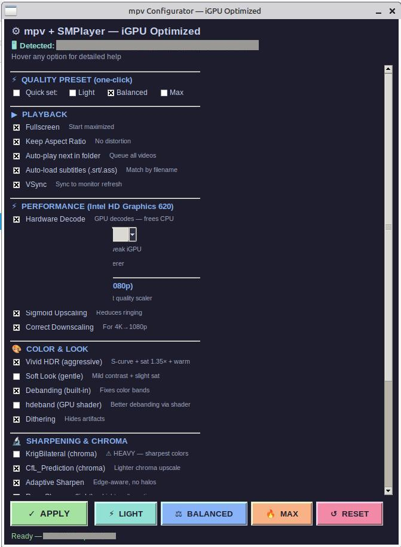

# iVivid

**Make every frame pop on your Linux laptop. No dedicated GPU needed.**

Supercharge video playback on integrated graphics. One click applies HDR-like color, sharp upscaling, and punchy audio — auto-tuned for your specific iGPU.

## Why

Your laptop's integrated GPU can make movies look dramatically better — but finding the right mpv settings, shaders, and audio filters means hours of tinkering. iVivid does it all in one click.

## Install

    sudo apt install python3-tk mpv smplayer

## Run

    python3 ivivid.py

## How it works

1. Open the GUI
2. Select a quality preset: **LIGHT** / **BALANCED** / **MAX**
3. Tweak individual options (hover any checkbox for detailed help)
4. Click **APPLY**
5. Play: `mpv /path/to/video.mp4`

Works with both **mpv** and **SMPlayer** (mpv engine).

## Features

### Video

- 480p to 1080p fullscreen, no black bars, no crop
- Pseudo-HDR look (S-curve contrast, gamma lift, 1.35x saturation, warm tint, soft-clip)
- Adaptive sharpening (edge-aware, no halos or ringing)
- Chroma upscaling (KrigBilateral or CfL_Prediction)
- Debanding (built-in + hdeband GPU shader)
- Temporal dithering
- EWA Lanczos Sharp scaler + sigmoid upscaling
- Hardware decode (VA-API)
- Auto-play next video in folder

### Audio

- Bass boost (0-20dB slider)
- Treble boost (0-20dB slider)
- 3D Surround (stereowiden: narrow / wide / ultra)
- Dynamic compressor
- Loudness normalize (EBU R128)
- Volume up to 150%

### System

- iGPU auto-detection (Intel HD 620, UHD 630, Iris Xe, AMD Radeon)
- Quality presets auto-tuned per iGPU tier
- XFCE compositor auto-disable (biggest performance win)
- Dark theme, tooltips, zero pip dependencies

## Quality Presets

| Preset | Shaders | Best for |
|--------|---------|----------|
| **LIGHT** | soft_look + adaptive-sharpen | HD 620, UHD 630 (guaranteed 60fps) |
| **BALANCED** | vivid_hdr + CfL + adaptive-sharpen | HD 620, UHD 630, Iris Plus |
| **MAX** | vivid_hdr + KrigBilateral + hdeband + adaptive-sharpen | Iris Xe, AMD iGPU 700M+ |

## Hotkeys (during playback)

| Key | Action |
|-----|--------|
| F | Toggle fullscreen |
| CTRL+1 | Shaders ON |
| CTRL+2 | Shaders OFF |
| + / - | Volume +/-5 |

## Requirements

- Python 3.8+
- mpv 0.39+
- python3-tk
- Linux (XFCE preferred, GNOME/KDE work)
- Intel or AMD iGPU with VA-API support
- No pip packages (stdlib only)

## Project Structure

    ivivid/
    ├── ivivid.py                # Main application (single file)
    ├── PROJECT.txt              # Project metadata
    ├── README.md
    ├── LICENSE
    ├── CONTRIBUTING.md
    ├── CHANGELOG.md
    ├── .gitignore
    ├── .gitattributes
    ├── .editorconfig
    ├── NOTES.md
    └── .github/
        ├── ISSUE_TEMPLATE/
        ├── PULL_REQUEST_TEMPLATE.md
        └── workflows/
            └── ci.yml

## License

MIT - see [LICENSE](LICENSE)

## Contributing

See [CONTRIBUTING.md](CONTRIBUTING.md)

## Acknowledgments

- mpv and its shader ecosystem
- KrigBilateral, CfL_Prediction, adaptive-sharpen (boned101)
- ravu, hdeband (akirasuper)
- Python stdlib (tkinter, subprocess, json)

---

**One file. One click. Better movies.**
